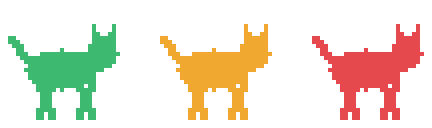

 

안녕하세요, **kizzi**입니다. 풀스택으로 일합니다. 
기획, 디자인, 개발, 검수를 따로 나누지 않고 AI랑 같이 혼자 끝까지 갑니다. 사람이 하나니까 결정이 빠르고, 떠오른 건 그날 바로 만들어 봅니다.

- 🧠 **Claude Code**와 **Cursor**를 페어 프로그래머처럼 씁니다. 아이디어 정리부터 화면, 코드, 검수까지 전부 주고받으면서.
- ☕ **Java · Spring Boot**가 뿌리입니다. TypeScript / Next.js 프론트와 Python AI 서비스로 넓혀 왔습니다.
- 🤖 RAG 파이프라인, LLM 평가, AI 교수 시스템을 만들었습니다.
- 🦀 요즘은 **Rust**로 [DevMem](https://github.com/kizzis/devmem)이라는 Windows 트레이 앱을 만드는 중입니다.

 

## 🔁 How I work

<table align="center">
  <tr>
    <td align="center" width="150">📝 <b>기획</b> Plan</td>
    <td align="center" width="30">→</td>
    <td align="center" width="150">🎨 <b>디자인</b> Design</td>
    <td align="center" width="30">→</td>
    <td align="center" width="150">⚙️ <b>개발</b> Build</td>
    <td align="center" width="30">→</td>
    <td align="center" width="150">✅ <b>검수</b> Review</td>
  </tr>
  <tr>
    <td colspan="7" align="center">네 단계 전부, AI와 함께 한 사람이 끝까지.</td>
  </tr>
</table>

 

## 🐱 Featured: DevMem

  

🟢 여유 · 🟡 주의 · 🔴 위험. 메모리가 부족할수록 고양이가 빨리 달립니다.

IDE, 브라우저, WSL/Docker, Gradle, Node dev server를 한꺼번에 띄우면 PC가 느려집니다. 
**DevMem**은 트레이에 사는 작은 고양이로 메모리가 얼마나 부족한지 보여 주고, 무엇이 메모리를 먹는지 개발 단위로 묶어 알려 주고, 안 쓰는 것만 골라 정리합니다.

- 메모리 사용량 약 15MB, 실행 파일 약 4MB
- 사용 중인 프로그램은 지키고, 정리는 확인 창을 거친 뒤에만
- 1시간 넘게 안 본 브라우저 탭 잠재우기, 누수 의심 프로세스 감지

  
  
  

 

## 📦 Projects

  
  

  
  

- **Flow** · 출퇴근, 근무 시간, 휴가와 연장 근무를 한곳에서 관리하는 인사 서비스. Spring Boot 백엔드 + Next.js 프론트
- **elice-data-web-service-project** · 서울시 대중교통 분실물·습득물 데이터로 잃어버린 물건을 찾아 주는 서비스
- **Spring-Shop** · Spring Boot로 만든 쇼핑몰

 

## 🛠 Tech Stack

**Backend** 

**Frontend** 

**Systems** 

**AI · Vibe Coding** 

**Infra · Data** 

 

## 📊 GitHub Stats

  
  

  

  

 

  Built with AI, reviewed by me. 🤖🤝🧑‍💻

